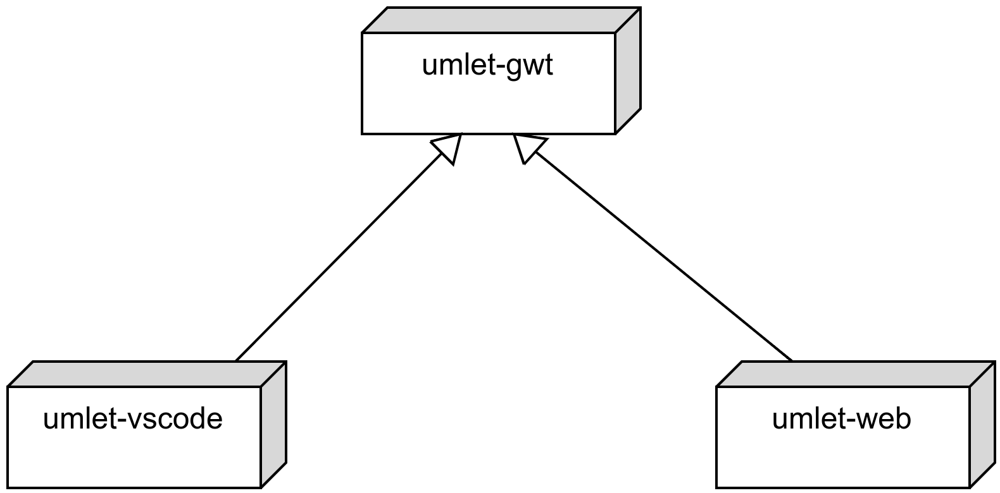
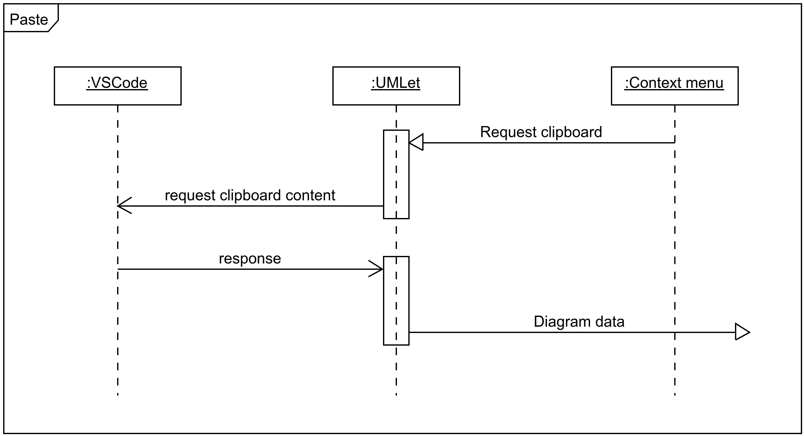

# UMLet-VSCode

This project contains our UMLet Visual Studio Code extension!

## Architecture

The extension uses _umlet-gwt_ as library and extends it by specific functionality required by the VSCode environment.

In general, _umlet-gwt_ handles most of the functionality required for UMLet to work. For special cases, like clipboard
handling, a custom implementation especially for VSCode has to be developed. This is done by replacing an interface or 
abstract class by an actual implementation of the functionality. The use of _umlet-gwt_ and all replacements are
 declared in _module.gwt.xml_.

To run the extension, a [Custom Editor](https://code.visualstudio.com/api/extension-guides/custom-editors) is created
which handles the setup and communication between UMLet and VSCode. You can find the code inside
_UmletEditorProvider.ts_.

The communication between VSCode and UMLet relies on 
[_message passing_](https://code.visualstudio.com/api/extension-guides/webview#scripts-and-message-passing). Since this 
communication is asynchronously, the architecture of a functionality has to be planned accordingly. An example workflow
of pasting the clipboard using the context menu of UMLet is shown in the following.

## Export on save

`ExportOnSave` listens to `workspace.onDidSaveTextDocument` because UMLet is a `CustomTextEditorProvider`:
VS Code owns UXF persistence. Each resolved webview is registered with its document URI. Automatic export never
uses the last-active-panel heuristic used by manual commands.

The renderer announces `pngExportReady` after initialization. `requestExportPngOnSave` carries a request ID,
the saved XML snapshot and export scale. GWT parses a separate diagram with strict error handling, normalizes
its zoom and uses the same `CanvasUtils` PNG renderer as manual export. `exportPngOnSave` returns the ID and
PNG data or an error. This separate protocol leaves manual exports and their Save dialogs unchanged.

Each URI has at most one active render/write and one queued snapshot (the newest save). Responses from other
panels or superseded requests are ignored. Writes remain serialized through panel closure/reopening. Renderer
readiness and responses time out after 30 seconds; writes are awaited because filesystem operations cannot be
cancelled safely. Disposing panels releases listeners and timers. No source-file writes occur in this path.

## Tests

Build the GWT application and extension first (`mvn install -pl umlet-vscode -am` from the repository root), then
run `npm test` in this directory. It compiles TypeScript, runs ESLint, and launches the Mocha tests in an isolated
VS Code profile and temporary workspace. Set `VSCODE_EXECUTABLE_PATH` to an existing VS Code executable to avoid
downloading a test instance. Test output goes into `target/out`; the packaged extension remains in `target/dist`.
